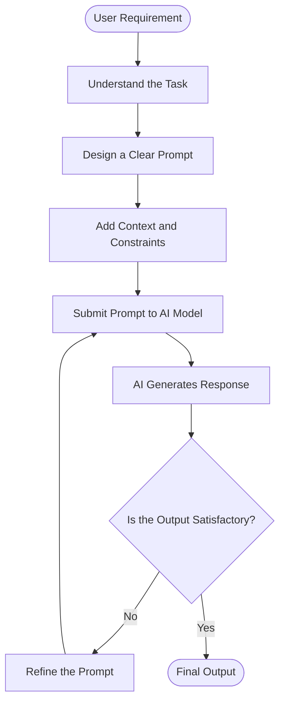

# EX-NO-7: Prompt Engineering for Effective Communication with AI

## AIM

To understand and apply prompt engineering techniques to communicate effectively with Artificial Intelligence (AI) models and generate accurate, relevant, structured, and useful outputs.

---

## INTRODUCTION

Prompt engineering is the process of designing and structuring instructions given to an AI model to obtain accurate and useful responses.

It acts as a communication bridge between human users and AI systems. By providing clear instructions, relevant context, examples, and constraints, users can guide AI models to produce better results.

## GOALS OF PROMPT ENGINEERING

1. **Improve Accuracy:** Reduce errors and incorrect information (hallucinations) by providing precise context and instructions.
2. **Control Tone and Format:** Ensure that AI responds in a specific style, length, or format, such as bullet points, tables, JSON, or professional language.
3. **Handle Complex Tasks:** Divide complex problems into smaller and manageable tasks using structured prompting techniques.
4. **Bridge Vague Inputs:** Convert general user requests into clear, structured, and actionable instructions.

---

## PROMPT ENGINEERING WORKFLOW

The following workflow illustrates how prompt engineering works:



---

## PROMPTING TECHNIQUES

### 1. Zero-Shot Prompting

Zero-shot prompting involves giving the AI a direct task or question without providing any examples. The model uses its pre-trained knowledge to generate the response.

**Example:**

> "Summarize this article in three bullet points."

**Application:** Simple questions, summarization, and general-purpose tasks.

### 2. Few-Shot Prompting

Few-shot prompting provides a small number of input-output examples within the prompt. These examples help the AI understand the expected pattern, format, or writing style.

- **One-shot prompting:** Uses one example.
- **Few-shot prompting:** Uses multiple examples.

**Example:**

> "Here are two examples of friendly email replies. Write a third reply in the same style."

**Application:** Text classification, formatting, and generating content in a specific style.

### 3. Chain-of-Thought (CoT) Prompting

Chain-of-Thought prompting encourages an AI model to approach a complex problem through intermediate reasoning steps before producing a final answer.

**Example:**

> "Solve this mathematical problem carefully and provide the key steps and final answer."

**Application:** Mathematical problems, logical reasoning, and complex problem-solving.

### 4. Role-Based Prompting

Role-based prompting assigns the AI a specific role, profession, or perspective to influence its response, vocabulary, and approach.

**Example:**

> "Act as an experienced financial advisor and explain the basics of investment planning."

**Application:** Education, professional guidance, technical explanations, and domain-specific tasks.

### 5. Instruction-Based Prompting

Instruction-based prompting uses clear and direct commands to specify what the AI should do, including constraints, output formats, and rules.

**Example:**

> "Write a product description in under 50 words using a professional tone."

**Application:** Content generation, report writing, and structured responses.

### COMPARISON OF PROMPTING TECHNIQUES

| Technique | Main Purpose | Example |
|---|---|---|
| Zero-Shot | Direct instructions without examples | Summarize an article |
| Few-Shot | Learn a pattern from examples | Write a similar email |
| Chain-of-Thought | Break down complex reasoning | Solve a mathematical problem |
| Role-Based | Assign a specific role | Act as a teacher |
| Instruction-Based | Give explicit commands | Write under 50 words |

---

## ESSENTIAL PROMPT ENGINEERING TECHNIQUES

- **Context Framing:** Define the role, target audience, background information, tone, and expected output format.
- **Advanced Prompting:** Use examples and structured reasoning instructions to handle complex tasks.
- **Parameter Tuning:** Adjust model settings such as temperature and top-p to influence creativity and response diversity. Availability depends on the AI platform.

---

## PRACTICE PROMPTS AND THEIR APPLICATIONS

### 1. DOCUMENT GENERATION PROMPTS

The following prompts can be used to generate different types of documents and content:

| Prompt | Purpose |
|---|---|
| Visualize learning | Convert learning concepts into visual explanations |
| Generate handwritten image | Create handwritten-style visual content |
| Sticky notes | Organize information into short notes |
| Teacher | Generate educational explanations |
| Doctor | Explain general medical concepts |
| Lawyer | Explain general legal concepts |
| Ideas 10 + Research Field | Generate ten ideas related to a research field |

### 2. GENERAL-PURPOSE QUESTIONS

These prompt templates can be modified according to the user's requirements.

1. Explain [TOPIC] like I am a beginner.
2. Give me 10 ideas for [GOAL].
3. Write a professional [TYPE] for [AUDIENCE].
4. Improve this text and create a plan for [GOAL].
5. Create a step-by-step plan for [GOAL].

### 3. IMAGE GENERATION PROMPTS

Style keywords can be included in image-generation prompts to guide the visual appearance of generated images.

| Prompt Keyword | Purpose |
|---|---|
| `/underwater` | Underwater scene |
| `/pencilsketch` | Pencil drawing |
| `/goldenhour` | Golden-hour lighting |
| `/lowpoly` | Low-poly 3D style |
| `/wildlife` | Wildlife photography |
| `/cinematicphoto` | Movie-like photography |
| `/interior` | Interior design visualization |
| `/anime` | Anime artwork |
| `/macrophoto` | Macro photography |
| `/oilpainting` | Oil painting style |
| `/droneview` | Drone aerial view |
| `/blackandwhite` | Monochrome style |
| `/pixelart` | Pixel art |
| `/architecturephoto` | Architectural photography |
| `/hyperrealistic` | Highly realistic appearance |

**Note:** These are illustrative prompt keywords, not universal commands. Their behavior depends on the AI image-generation platform.

---

## APPLICATION PROMPTS

### 1. TRAVEL GUIDE APPLICATION

**Prompt:**

"I want you to act as a travel guide. I will provide my location, and you will suggest places to visit nearby. In some cases, I will also specify the type of places I want to visit. Suggest other places of a similar type that are close to my first location.

My first request is: I am in Istanbul, Beyoğlu, and I want to visit only museums."

**Purpose:**
- Provides location-based recommendations.
- Filters suggestions according to the user's interests.
- Helps users plan visits efficiently.

### 2. EMAIL MARKETING APPLICATION

**Prompt:**

"I'm looking for a [TYPE OF EMAIL] that will speak directly to the needs and pain points of my [IDEAL CUSTOMER PERSONA] and persuade them to take [DESIRED ACTION] with a sense of urgency and a strong offer."

**Purpose:**
- Creates targeted marketing emails.
- Addresses customer needs and problems.
- Encourages the intended audience to take action.

### 3. STORYTELLING APPLICATION

**Prompt:**

"I want you to act as a storyteller. You will create entertaining stories that are engaging, imaginative, and captivating for the audience. The stories can be fairy tales, educational stories, historical stories, or other creative forms.

Depending on the target audience, choose suitable themes and topics.

My first request is: I need an interesting story about perseverance."

**Purpose:**
- Generates creative and engaging stories.
- Adapts content to different audiences.
- Supports educational and entertainment applications.

---

## CORE TAKEAWAYS

1. **Clarity Matters:** Specific instructions and explicit constraints help prevent vague or irrelevant responses.
2. **Cost-Effective Optimization:** Improving prompts is a quick and economical way to improve output quality without retraining AI models.
3. **Advanced Techniques:** Role assignments, examples, and structured reasoning instructions help guide AI responses.
4. **Context Is Important:** Providing sufficient background information helps AI understand the user's requirements.
5. **Continuous Refinement:** Testing and modifying prompts can improve the quality of generated outputs.

---

## RESULT

Prompt engineering techniques were studied and applied to different tasks, including document generation, image generation, travel recommendations, email marketing, and storytelling.

The different prompting techniques demonstrated how clear instructions, context, examples, and constraints can guide AI models to produce more useful and relevant responses.

## CONCLUSION

Prompt engineering serves as an essential communication bridge between human intent and machine understanding. It helps improve the quality, accuracy, relevance, and structure of AI-generated outputs.

Although the field is evolving towards broader concepts such as context engineering and AI system design, the fundamental ability to communicate clearly with AI remains important for effective human-AI interaction.

---

## REFERENCES

1. OpenAI Documentation – https://platform.openai.com/docs/
2. Google AI for Developers – https://ai.google.dev/
3. Prompt Engineering Guide – https://www.promptingguide.ai/

---

## SCREENSHOTS / OUTPUT

Add screenshots of your practical prompt experiments in the `images` folder of your GitHub repository.

Suggested screenshots:

1. Zero-shot and few-shot prompting outputs.
2. Role-based prompting output.
3. AI-generated document.
4. AI-generated image.
5. Travel guide response.
6. Email marketing response.
7. Storytelling response.

Example Markdown image syntax:

```markdown


```
